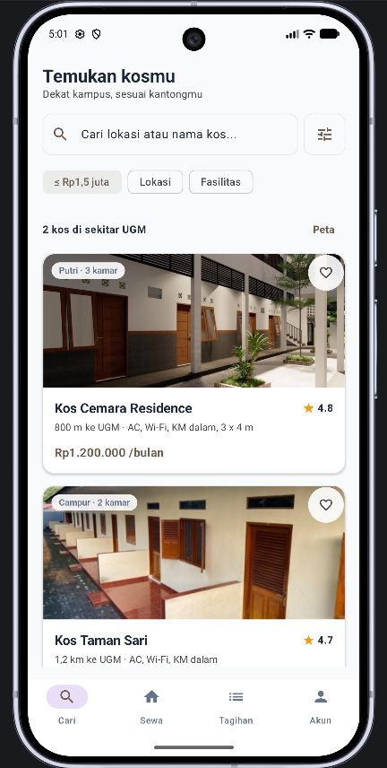
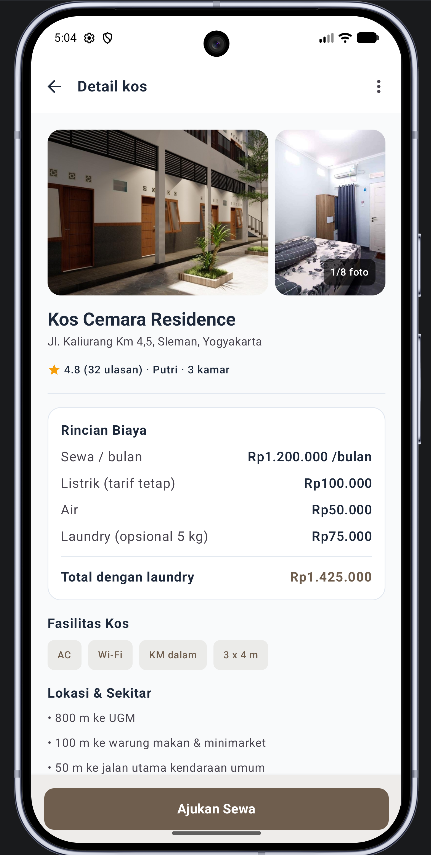
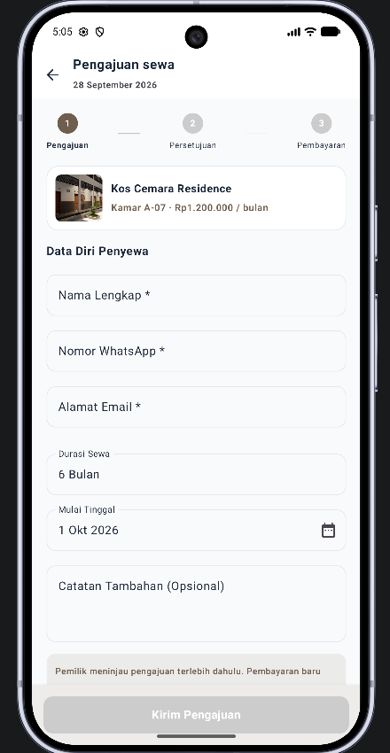
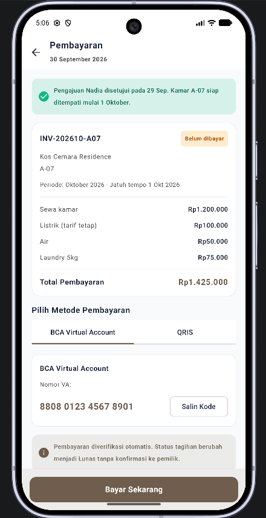
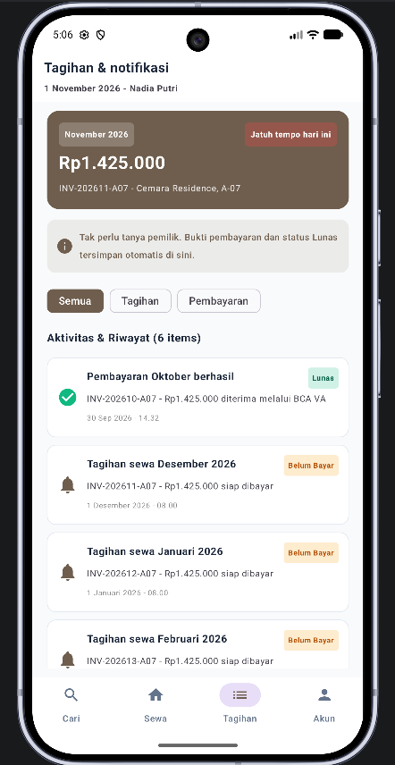

# Kostelle
### IF570L — Lab Mobile Application Programming
**Ujian Tengah Semester - Semester Ganjil 2026/2027**
Universitas Multimedia Nusantara

---

## Overview

Kostelle adalah konsep aplikasi Android yang menggabungkan marketplace kos dengan fitur manajemen sewa. Aplikasi ini membantu calon penyewa menemukan kos berdasarkan budget, lokasi, dan fasilitas yang diinginkan, sekaligus menampilkan rincian biaya sewa seperti sewa kamar, listrik, air, dan laundry dalam satu tempat.

Aplikasi dibangun dengan Kotlin dan Jetpack Compose, menggunakan Material 3 untuk antarmuka dan arsitektur MVVM untuk mengelola state UI dan logika layar. Implementasi saat ini menggunakan dummy data sebagai sumber data sementara.

## Features

- **Pencarian kos** - Jelajahi dan cari kos berdasarkan nama atau lokasi.
- **Detail kos** - Lihat foto, harga, fasilitas, dan preview peta.
- **Pengajuan sewa** - Kirim pengajuan sewa melalui form dengan validasi real-time.
- **Prototipe UI pembayaran** - Jelajahi alur pembayaran mock untuk BCA Virtual Account dan QRIS.
- **Notifikasi tagihan** - Lihat notifikasi tagihan dan status pembayaran.
- **Antarmuka konsisten** - Tema Material 3 custom dengan nuansa coklat earthy dan aksen hijau.

## Group Members

1. `[Abthal Akbar]` - `[00000121788]`
2. `[Ceryne]` - `[00000135652]`
3. `[Francent Jienarta]` - `[00000115728]`
4. `[Josiah Maximus Suryadi]` - `[00000108749]`

## Team Workflow

Proyek diorganisir dalam beberapa checkpoint pengembangan, dengan tanggung jawab dibagi berdasarkan area fitur. Tim menyusun struktur proyek, design system, dan alur navigasi bersama sebelum implementasi.

1. Perencanaan dan konvensi proyek didokumentasikan di `PLAN.md`.
2. Setiap anggota mengerjakan fitur yang ditugaskan di branch Git masing-masing.
3. Pekerjaan yang selesai di-merge ke branch utama setelah review.
4. Tim berkoordinasi melalui WhatsApp dan diskusi tatap muka.
5. Aplikasi terintegrasi direview dan diuji bersama sebelum dikumpulkan.

## Individual Contributions

Sesuaikan nama dan NIM di bawah dengan pembagian tugas aktual.

### Anggota Team - `[Ceryne]` (`[00000135652]`)

**Screen 1: Foundation, Tema Material 3, dan Search List**

- Menyiapkan struktur proyek dan tema Material 3 custom.
- Mengimplementasikan `Color.kt`, `Type.kt`, `Shape.kt`, dan `Theme.kt`.
- Mengembangkan `SearchScreen`, `SearchViewModel`, `KosCard`, dan `KostellaBottomBar`.
- Branch: `feature/cp1-search-list`

### Anggota Team - `[Francent Jienarta]` (`[00000115728]`)

**Screen 2: Navigasi dan Detail Kos**

- Mengimplementasikan `NavGraph` dan `ScreenRoutes`.
- Mengembangkan `DetailScreen` dan `DetailViewModel`.
- Menggunakan `SavedStateHandle` untuk mengirim `kosId` yang dipilih.
- Menambahkan preview peta statis.
- Branch: `feature/cp2-detail-screen`

### Anggota Team - `[Abthal Akbar]` (`[00000121788]`)

**Screen 3: Form Pengajuan Sewa dan Validasi**

- Mengembangkan `ApplicationScreen` dan `ApplicationViewModel`.
- Mengimplementasikan `StepIndicator`.
- Menambahkan validasi untuk email, nomor telepon, dan field numerik.
- Mengonfigurasi tipe keyboard yang sesuai untuk field form.
- Branch: `feature/cp3-application-form`

### Anggota Team - `[Josiah Maximus Suryadi]` (`[00000108749]`)

**Screen 4: Prototipe UI Pembayaran**

- Mengembangkan `PaymentScreen` dan `PaymentViewModel`.
- Mengimplementasikan `Invoice.kt`.
- Menambahkan interaksi mock copy-to-clipboard BCA Virtual Account.
- Mengintegrasikan gambar mockup QRIS dan loading state verifikasi pembayaran.
- Branch: `feature/cp4-payment-native-mockup`

### Anggota Team - `[Abthal Akbar]` (`[00000121788]`)

**Screen 5: Notifikasi Tagihan dan Integrasi Final**

- Mengembangkan `NotificationScreen` dan `NotificationViewModel`.
- Mengimplementasikan `NotificationCard` dan `NotificationItem.kt`.
- Menambahkan filter notifikasi untuk tagihan dan status pembayaran.
- Branch: `feature/cp5-notifications-and-final`

## Project Structure

Package aplikasi: `org.umn.utsmap`

```text
org.umn.utsmap/
├── MainActivity.kt
├── PLAN.md
├── README.txt
├── res/
│   └── drawable/
│       ├── kos1.jpg
│       ├── kos2.jpg
│       ├── kos3.jpg
│       ├── kos4.jpg
│       ├── map.png
│       └── qris.png
├── data/
│   ├── model/
│   │   ├── Kos.kt
│   │   ├── ApplicationForm.kt
│   │   ├── Invoice.kt
│   │   └── NotificationItem.kt
│   └── dummy/
│       └── DummyData.kt
├── ui/
│   ├── theme/
│   │   ├── Color.kt
│   │   ├── Shape.kt
│   │   ├── Theme.kt
│   │   └── Type.kt
│   ├── components/
│   │   ├── KostellaBottomBar.kt
│   │   ├── KosCard.kt
│   │   ├── NotificationCard.kt
│   │   └── StepIndicator.kt
│   └── screen/
│       ├── search/
│       │   ├── SearchScreen.kt
│       │   └── SearchViewModel.kt
│       ├── detail/
│       │   ├── DetailScreen.kt
│       │   └── DetailViewModel.kt
│       ├── application/
│       │   ├── ApplicationScreen.kt
│       │   └── ApplicationViewModel.kt
│       ├── payment/
│       │   ├── PaymentScreen.kt
│       │   └── PaymentViewModel.kt
│       └── notification/
│           ├── NotificationScreen.kt
│           └── NotificationViewModel.kt
└── navigation/
    ├── NavGraph.kt
    └── ScreenRoutes.kt
```

## Demo Screenshots

Tambahkan screenshot yang sesuai ke proyek dan pastikan nama file cocok dengan referensi di bawah.

### 1. Search Screen

Menampilkan daftar kos, search bar, filter chips, dan card listing dengan foto, nama, harga, rating, dan jarak.



### 2. Detail Screen

Menampilkan foto kos, rincian biaya sewa, fasilitas, preview peta, dan tombol **Ajukan Sewa**.



### 3. Rental Application Screen

Menampilkan form pengajuan sewa, step indicator, ringkasan kos, dan validasi field real-time.



### 4. Payment Screen

Mendemonstrasikan prototipe UI pembayaran BCA Virtual Account dan QRIS, termasuk interaksi copy-code dan loading state verifikasi.



### 5. Notifications Screen

Menampilkan notifikasi tagihan dan status pembayaran, dengan filter untuk semua notifikasi, tagihan, dan pembayaran, serta badge status lunas.



## Technology Stack

| Category | Technology |
|---|---|
| Language | Kotlin |
| UI Framework | Jetpack Compose |
| Design System | Material 3 dengan tema custom |
| Architecture | MVVM |
| Navigation | Navigation Compose |
| State Management | `mutableStateOf`, `StateFlow`, `SavedStateHandle` |
| Data Source | Dummy data lokal; tanpa integrasi backend |

## Getting Started

### Requirements

- Android Studio Hedgehog atau lebih baru
- JDK 17
- Emulator Android atau perangkat Android fisik
- Minimum SDK 24

### Run the Application

1. Buka proyek di Android Studio.
2. Pastikan JDK 17 sudah dikonfigurasi.
3. Sync proyek Gradle.
4. Jalankan emulator atau hubungkan perangkat Android.
5. Pilih **Build & Run** untuk menjalankan Kostella.

Aplikasi akan terbuka pada Search Screen.

© 2026 Kostelle Team - IF570L Lab Mobile Application Programming
Universitas Multimedia Nusantara
